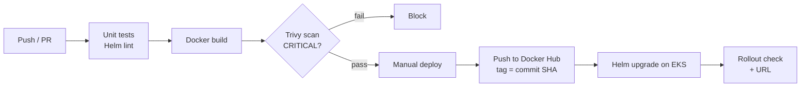

# flask-eks-cicd


End-to-end CI/CD for a containerized Flask service on AWS EKS with GitHub Actions: unit tests, Helm lint, Docker build, Trivy vulnerability gate, then deployment to EKS with Helm. An Argo CD Application is included as a GitOps alternative.

## Pipeline



| Trigger | Jobs | Needs cloud credentials? |
| --- | --- | --- |
| Push / pull request | `test` → `build-and-scan` | No |
| Manual (`workflow_dispatch`) | `test` → `build-and-scan` → `deploy` | Yes (Docker Hub, AWS) |

## Security and reliability choices

- **Vulnerability gate:** Trivy fails the build on fixable CRITICAL CVEs before anything is pushed
- **Immutable images:** deployments use the commit SHA tag, not just `latest`
- **Non-root container:** slim base image, dedicated UID, gunicorn instead of the Flask dev server
- **Pod hardening:** `runAsNonRoot`, read-only root filesystem, all Linux capabilities dropped, no privilege escalation
- **Health checks:** readiness and liveness probes on `/health`, resource requests and limits
- **No secrets in code:** DB settings come from environment variables; CI uses GitHub encrypted secrets

## GitOps option (Argo CD)

`argocd/flask-app.yaml` points Argo CD at `helm/flask-app` in this repo with auto-sync and self-heal. Use it **instead of** the pipeline's Helm step (not both, or they fight over the same Deployment): set `image.repository` and `image.tag` in `values.yaml`, then `kubectl apply -f argocd/flask-app.yaml`.

## Endpoints

| Path | Response |
| --- | --- |
| `/` | Plain-text hello |
| `/health` | `{"status": "ok"}` |
| `/users` | Users from MySQL, or `503` if no database is configured |

## Run locally

```bash
pip install -r requirements.txt pytest
pytest -q
docker build -t flask-hello-world .
docker run -p 5000:5000 flask-hello-world
curl localhost:5000/health
```

## Repository layout

```
.
├── app.py                     # Flask app
├── test_app.py                # pytest tests
├── Dockerfile                 # non-root, gunicorn
├── helm/flask-app/            # Helm chart (deployment, service, values)
├── argocd/flask-app.yaml      # Argo CD Application (GitOps alternative)
└── .github/workflows/cicd.yaml
```

## Stack

Python · Flask · Docker · GitHub Actions · Trivy · Helm · Kubernetes (AWS EKS) · Argo CD

## Next steps

- GitHub OIDC role for AWS instead of static access keys
- Push images to Amazon ECR and sign them (cosign)
- Ingress + TLS instead of NodePort
